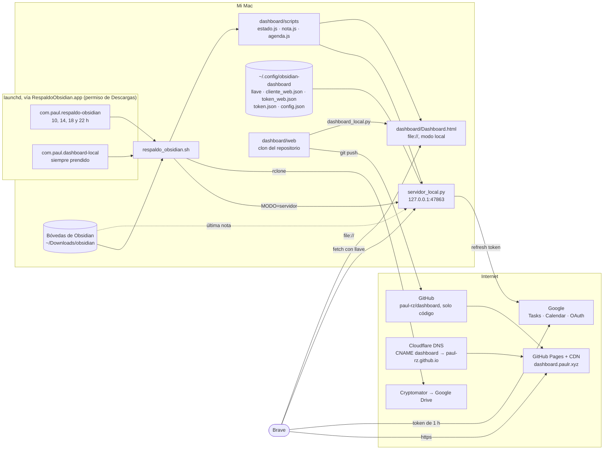
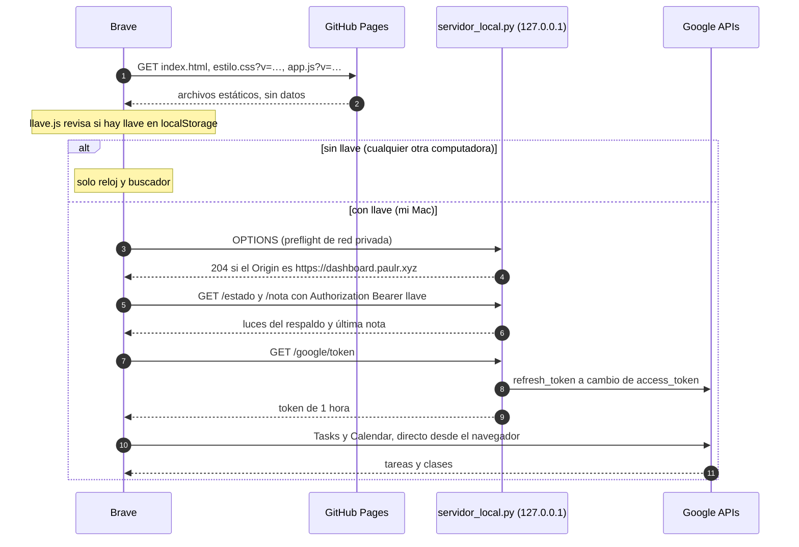
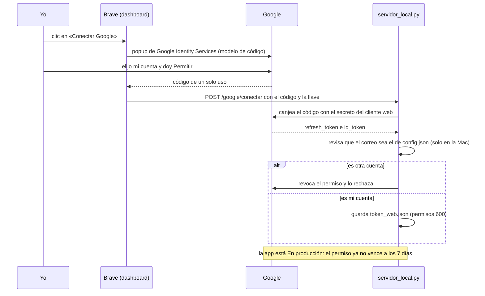
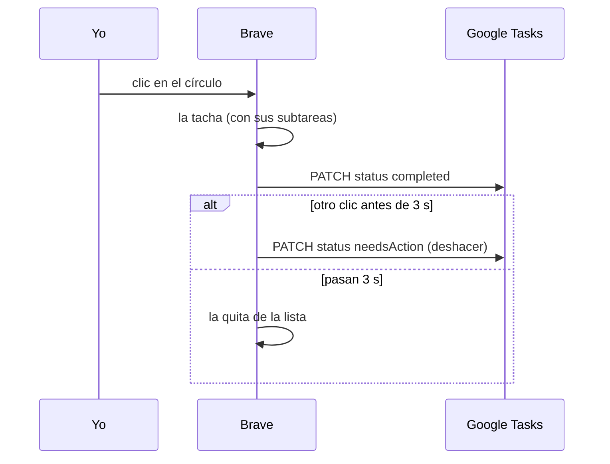
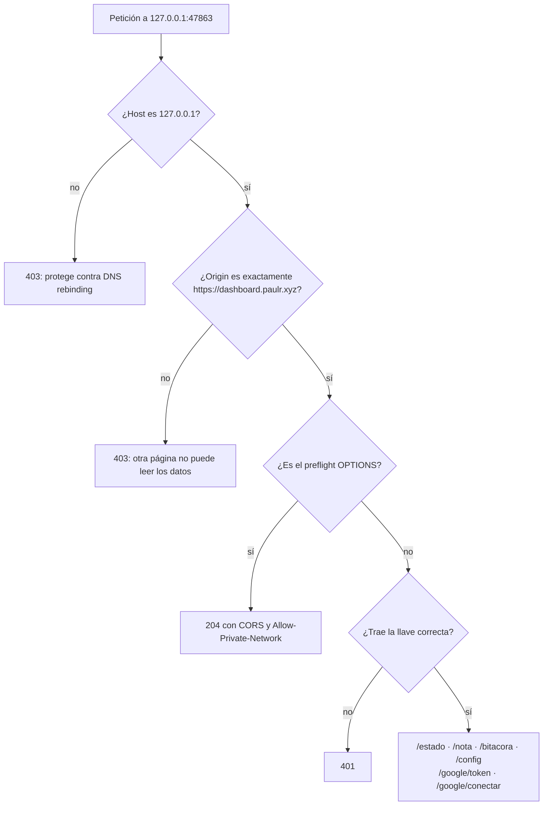
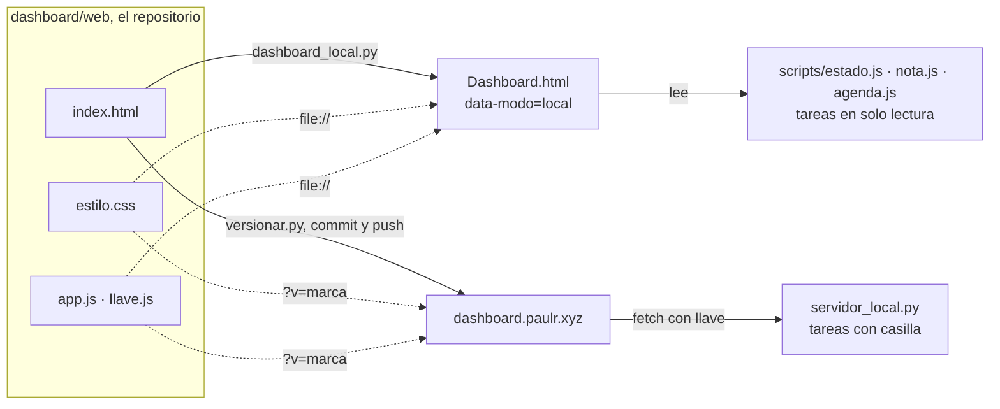
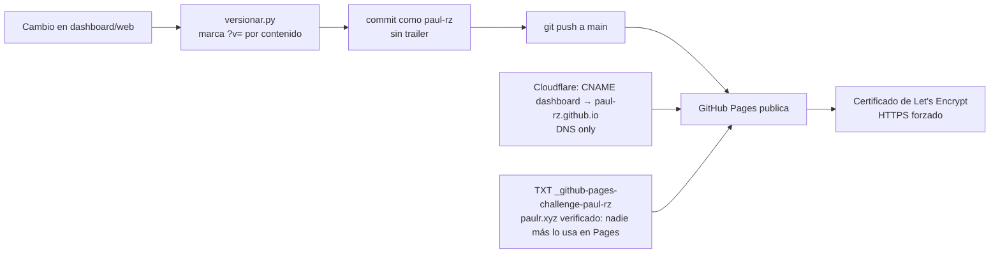

# dashboard

Mi página de inicio, en https://dashboard.paulr.xyz (GitHub Pages).

El repositorio es público y solo tiene código: ningún dato, ninguna llave ni secreto.

- `index.html`, `estilo.css`, `llave.js` y `app.js` son la página. Sin la llave de mi Mac
  solo muestra el reloj y el buscador.
- Las luces del respaldo, la última nota y el permiso de Google los da un servidor local
  que solo corre en mi Mac (`127.0.0.1:47863`) y no vive en este repositorio.
- Google se conecta con Google Identity Services (modelo de código, cliente "Aplicación
  web"). La página llama a Tasks y Calendar directamente, con tokens de una hora.
- `acerca.html` y `privacidad.html` son las páginas que pide Google para publicar la app.
- Antes de cada commit se corre `python3 versionar.py`: pone en las páginas una marca `?v=`
  según el contenido de `estilo.css`, `llave.js`, `app.js` y `favicon.svg`, para que ni el
  navegador ni el CDN de GitHub Pages sirvan una copia vieja.

## Dónde vive en la Mac

```
~/Downloads/obsidian/dashboard/   dentro de las bóvedas, así se respalda con ellas
├── Dashboard.html   página de inicio local (la genera scripts/dashboard_local.py)
├── web/             este repositorio
├── scripts/         servidor local, respaldo, nota y agenda, con sus datos (no están aquí)
└── docs/            brief, diagramas y el favicon original
```

Las rutas de los scripts salen de `scripts/rutas.py`, y los agentes de launchd le pasan a
`RespaldoObsidian.app` la ruta del script, así que mover la carpeta no obliga a recompilar.

## Cómo funciona

### 1. El panorama



### 2. Qué pasa al abrir dashboard.paulr.xyz



### 3. Conectar Google (una sola vez)



### 4. La casilla de una tarea



### 5. Cómo se protege el servidor local



La llave es aleatoria y vive en `~/.config/obsidian-dashboard/llave` y en el localStorage de mi
Brave. Si se borran los datos del sitio, se crea otra con
`python3 ~/Downloads/obsidian/dashboard/scripts/servidor_local.py --llave`.

### 6. Un solo código para las dos páginas



Si cambia `estilo.css` o `app.js`, el local cambia al recargar y la web cuando se sube.
`dashboard_local.py` solo hay que volver a correrlo si cambia `index.html`.

### 7. Cómo se publica



### Dónde vive cada cosa

| Qué | Dónde | ¿En GitHub? |
|---|---|---|
| Página, estilo y lógica | `dashboard/web` → `paul-rz/dashboard` | Sí, solo código |
| Inicio y privacidad para Google | `acerca.html`, `privacidad.html` | Sí |
| Servidor local | `~/Downloads/obsidian/dashboard/scripts/servidor_local.py` | No |
| Agente que lo deja prendido | `~/Library/LaunchAgents/com.paul.dashboard-local.plist` | No |
| Llave, secreto del cliente web y permisos de Google | `~/.config/obsidian-dashboard/` (600) | **Nunca** |
| Datos del respaldo, nota y agenda | `~/Downloads/obsidian/dashboard/scripts/*.js` | **Nunca** |
| Página local | `~/Downloads/obsidian/dashboard/Dashboard.html` (la genera `dashboard_local.py`) | No |

**Google Cloud**: la app "Obsidian dashboard" está
**En producción**, con inicio, privacidad y el dominio `paulr.xyz` en Branding. Tiene dos clientes:
`dashboard-mac` (escritorio, para el `Dashboard.html` local, solo lectura) y `dashboard-web`
(aplicación web, para la casilla real).
